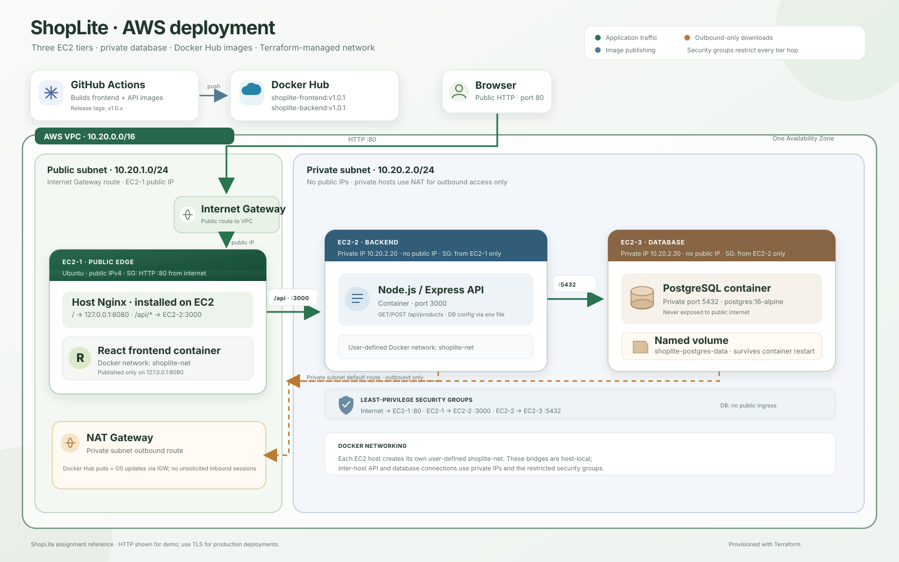
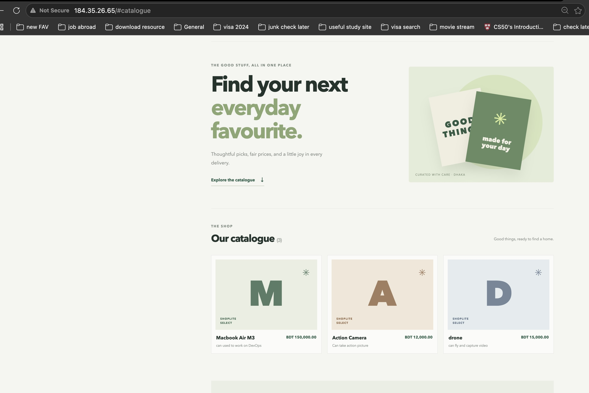

# ShopLite: Containerized 3-Tier Application on AWS EC2

ShopLite is a product catalogue with a dynamic React frontend, a Node.js/Express REST API, and PostgreSQL. It is designed for three Ubuntu EC2 instances in one VPC. Terraform provisions the infrastructure; Docker Hub hosts the frontend and backend images.

> **Assignment safety requirement:** PostgreSQL runs on a private EC2 instance with no public IP. Do not add a public database ingress rule. The EC2 instances pull prebuilt, version-tagged application images; no application source is copied to or built on an EC2 instance.

## Architecture



Each host creates its own user-defined Docker network. Docker networks are host-local; EC2-2 reaches PostgreSQL using EC2-3's private IP. A NAT Gateway provides outbound-only access for private hosts to install OS updates and pull public Docker Hub images. It does not expose the database to inbound internet connections.

## Repository layout

```text
backend/                 Express API, tests, and backend Dockerfile
frontend/                React + Vite application and frontend Dockerfile
deploy/nginx/            Host Nginx configuration template
infra/terraform/         VPC, EC2, routing, security groups, and bootstrap
```

## Run locally

Requirements: Docker and Docker Compose.

```sh
docker compose up --build
```

Open [http://localhost:8080](http://localhost:8080). The compose setup starts PostgreSQL with a named volume, the API, and the React app. API requests go through the frontend's local Nginx proxy, matching the single-origin production setup.

Run backend unit tests without Docker:

```sh
cd backend
npm ci
npm test
```

## API

The browser uses the same-origin API paths through Nginx:

| Method | Path | Purpose |
|---|---|---|
| `GET` | `/api/health` | Check API and database connectivity |
| `GET` | `/api/products` | List products, newest first |
| `POST` | `/api/products` | Add a product with `name`, optional `description`, and positive numeric `price` |

Example request:

```sh
curl -X POST http://localhost:8080/api/products \
  -H 'Content-Type: application/json' \
  -d '{"name":"Handwoven tote","description":"Made in Dhaka","price":1250}'
```

## Build and publish versioned Docker Hub images

GitHub Actions builds both images on pushes to `main`, on `v*` version-tag pushes, and on pull requests targeting `main` (build-only; no push). To enable publishing:

1. Create the public Docker Hub repositories `shoplite-frontend` and `shoplite-backend`.
2. In the GitHub repository, add the Actions **variable** `DOCKERHUB_USERNAME` with your Docker Hub username.
3. Add the Actions **secret** `DOCKERHUB_TOKEN` with a Docker Hub access token that can push to both repositories.
4. Push a release tag to publish the version-tagged images:

```sh
git tag v1.0.0
git push origin v1.0.0
```

For each component, the workflow publishes `v1.0.0` and `sha-<commit>` tags for that release. A push to `main` publishes `main`, `sha-<commit>`, and `latest`. Pull requests build both images for validation without logging in to Docker Hub or publishing. Use the exact version tag (for example `v1.0.0`) in `infra/terraform/terraform.tfvars`; the assignment requirement is satisfied by the release tag, not by `latest`.

### Build and push manually (optional)

Create public Docker Hub repositories named `shoplite-frontend` and `shoplite-backend`. Replace `YOUR_DOCKERHUB_USERNAME` with your own username. Choose a new version for each release; do not rely on the `latest` tag.

```sh
docker login
docker buildx build --platform linux/amd64 \
  -t muntaseri/shoplite-frontend:v1.0.0 \
  --push ./frontend
docker buildx build --platform linux/amd64 \
  -t muntaseri/shoplite-backend:v1.0.0 \
  --push ./backend
```

The Dockerfiles use runtime-only images/artifacts. Docker Hub images must be public so EC2 can pull them without storing registry credentials.


## Deploy to AWS

### 1. Prerequisites

- An AWS account and AWS CLI credentials configured locally.
- Terraform 1.5+ and an EC2 key pair already created in the target region.
- The two public, version-tagged Docker Hub images built above.
- A known public IPv4 CIDR for SSH administration, such as `laptop public IP/32`. Do not use `0.0.0.0/0` for SSH.

Terraform creates a VPC, one public subnet, one private subnet, an internet gateway, a NAT Gateway, three EC2 instances, and security groups. The private subnet has a default route through NAT for outbound package/image downloads; it has no inbound internet route. The database instance has no public IP.

### 2. Configure Terraform

```sh
cd infra/terraform
cp terraform.tfvars.example terraform.tfvars
```

Edit `terraform.tfvars`:

- Set `aws_region`, `key_name`, and your restricted `ssh_cidr`.
- Set the exact version-tagged image names from your public Docker Hub repositories.
- Set a unique `db_password` with at least 24 characters, using letters, digits, `_`, or `-`.

The password is marked sensitive but is included in Terraform state and EC2 user data so the backend can connect to PostgreSQL. Keep state local and access-restricted, never commit `terraform.tfvars`, state, plans, or user-data output. For a shared deployment, use an encrypted, access-controlled remote state backend and a secret-management design. Changing `db_password` through Terraform replaces the database instance; back up and plan a coordinated credential rotation before changing it because the database volume is attached to that instance.

`terraform init` downloads the AWS provider and prepares the working directory. Then validate, review the plan, and apply:

```sh
terraform init
terraform validate
terraform plan
terraform apply
```

After apply, display all Terraform outputs and retrieve individual values when needed:

```sh
terraform output
terraform output -raw frontend_public_ip
terraform output -raw backend_private_ip
terraform output -raw database_private_ip

```

```
backend_private_ip = "10.20.2.20"
database_private_ip = "10.20.2.30"
frontend_public_ip = "184.35.26.65"
```


Use the public IP to open the app and the private IPs for troubleshooting or SSH through the jump host. Bootstrap installs Docker on all hosts. EC2-1 installs Nginx directly on Ubuntu (not in a container), configures it from [`deploy/nginx/shoplite.conf.tftpl`](deploy/nginx/shoplite.conf.tftpl), and runs the frontend image. EC2-2 runs the API image. EC2-3 runs PostgreSQL with the named volume `shoplite-postgres-data`.

### 3. Verify

Visit `http://184.35.26.65/`. Add a product and refresh the page; the product should remain. Check API/database readiness:

```sh
curl http://184.35.26.65/api/health
curl http://184.35.26.65/api/products
```

The health endpoint returns `200` only when the API can query PostgreSQL. A `503` indicates the API is up but the database is not ready or reachable.

For administration, keep the EC2 private key on your computer and use SSH `ProxyJump` through EC2-1. Get the addresses from Terraform:

```
backend_private_ip = "10.20.2.20"
database_private_ip = "10.20.2.30"
frontend_public_ip = "184.35.26.65"
```


Append these entries to `~/.ssh/config`, replacing the example key path with the path to your EC2 `.pem` key and the public IP with the `frontend_public_ip` output. The private addresses below match the Terraform defaults; use the output values if they differ.

```sshconfig
Host shoplite-edge
    HostName 184.35.26.65
    User ubuntu
    IdentityFile ~/Downloads/3-tier-app.pem
    IdentitiesOnly yes

Host shoplite-backend
    HostName 10.20.2.20
    User ubuntu
    IdentityFile ~/Downloads/3-tier-app.pem
    IdentitiesOnly yes
    ProxyJump shoplite-edge

Host shoplite-db
    HostName 10.20.2.30
    User ubuntu
    IdentityFile ~/Downloads/3-tier-app.pem
    IdentitiesOnly yes
    ProxyJump shoplite-edge
```

Set restrictive permissions and connect using the aliases:

```sh
chmod 400 ~/Downloads/3-tier-app.pem
chmod 600 ~/.ssh/config
ssh shoplite-edge
ssh shoplite-backend
ssh shoplite-db
```

The Terraform key pair (`key_name`) must be attached to all three instances. The edge security group allows outbound SSH only to the backend and database security groups; their inbound SSH rules accept connections only from the edge security group. If these rules were added after the initial deployment, run `terraform apply` from `infra/terraform` before using `ProxyJump`. Do not copy the private key to EC2-1.

On each host, the `shoplite-net` user-defined Docker network is created. Inspect status with `sudo docker ps` and `sudo docker network inspect shoplite-net`. On EC2-3, confirm persistence with `sudo docker volume inspect shoplite-postgres-data`.

### 4. Update or roll back an application image

Publish a new immutable version tag. To deploy it, update the corresponding image variable in `terraform.tfvars` and apply; Terraform replaces only the app host whose user data changed, keeping the backend's private IP fixed. Alternatively, SSH to the relevant host and pull/recreate only that application container with the new explicit tag. On EC2-2, `/etc/shoplite/backend.env` is a root-readable environment file for container recreation. For a rollback, pull and run the previous known-good tag with the same container name, `shoplite-net` network, private-IP port binding, environment file, and restart policy. The database volume is independent of the API container and must not be deleted during an application rollback.

### 5. Destroy resources

After evaluation, destroy the infrastructure to avoid continuing EC2, NAT Gateway, and data-transfer charges:

```sh
cd infra/terraform
terraform destroy
```

Terraform deletion removes the EC2 instances and their local Docker data, including the database volume. Back up any data you need before destroying the instances.

## Security group design

| Instance / group | Inbound allowed | Reason |
|---|---|---|
| EC2-1 edge | TCP 80 from `0.0.0.0/0`; TCP 22 only from `ssh_cidr` | Public web entry point; restricted administration |
| EC2-2 backend | TCP 3000 only from EC2-1 security group; TCP 22 only from EC2-1 security group | API is reachable only through the edge host; administration via jump host |
| EC2-3 database | TCP 5432 only from EC2-2 security group; TCP 22 only from EC2-1 security group | PostgreSQL is reachable only from the backend; administration via jump host |

Security groups are stateful. No inbound database rule references a public CIDR. Private EC2 instances have no public IP. Docker publishes PostgreSQL only on EC2-3's private address, not `0.0.0.0`.
The edge host's outbound SSH access is limited to EC2-2 and EC2-3 security groups for jump-host administration; it does not permit SSH egress to arbitrary internet hosts.

## Assignment scenario questions

### Q1. Page loads, but product list is empty and API calls return 502

Start at the failing boundary and move inward. In the browser's network panel, inspect the failing `/api` URL and response. If the frontend container is restarting, inspect `sudo docker logs --tail 100 shoplite-frontend`; an Nginx error such as `host not found in upstream "backend"` means the frontend container is trying to resolve the backend by a Docker service name that is unavailable across EC2 hosts. The updated frontend Nginx config resolves that name at request time, while EC2-1's host Nginx sends `/api/*` directly to EC2-2's private IP. Publish and deploy a new frontend image version after applying that fix.

Then on EC2-1 check `sudo nginx -t`, `sudo systemctl status nginx`, and `sudo tail -n 100 /var/log/nginx/error.log`; verify the host Nginx upstream points to EC2-2's current private IP. From EC2-1, test `curl http://184.35.26.65:3000/api/health`. On EC2-2, inspect `sudo docker ps`, `sudo docker logs shoplite-backend`, the `shoplite-net` network, and the container's DB host, username, database, and password settings. From EC2-2, test the database's private IP on port 5432. On EC2-3, check the PostgreSQL container, logs, volume, and free disk space. Confirm security-group rules allow only edge-to-backend and backend-to-database traffic. Fix the specific broken hop, then recheck health and products through the public URL; do not expose PostgreSQL to troubleshoot.

### Q2. How can EC2-3 receive OS patches without breaking the database security rule?

The private subnet routes outbound traffic through the NAT Gateway. An administrator connects through the restricted EC2-1 jump host and runs the OS package manager on EC2-3:

```sh
ssh shoplite-db
sudo apt-get update && sudo apt-get upgrade -y
```

The instance initiates HTTPS connections to package repositories through NAT. NAT allows return traffic for those outbound connections but does not permit unsolicited internet-initiated database connections. The database security group remains restricted to EC2-2 on port 5432.

### Q3. New backend release breaks product creation; rollback required within two minutes

Keep the previous image tag available and immutable. On EC2-2, pull the previous image and recreate only the API container with its existing environment settings, Docker network, and restart policy:

```sh
sudo docker pull muntaseri/shoplite-backend:v1.0.0
sudo docker rm -f shoplite-backend
sudo docker run -d \
  --name shoplite-backend \
  --network shoplite-net \
  --restart unless-stopped \
  -p 10.20.2.20:3000:3000 \
  --env-file /etc/shoplite/backend.env \
  muntaseri/shoplite-backend:v1.0.0
```

As `v1.0.0` with the previous known-good tag. The database container and named volume remain untouched. Verify `/api/health`, list products, and test a new product through EC2-1. For a repeatable release process, maintain the exact image tags and deployment parameters for the current and prior release; never use `latest` as the rollback reference.

### Q4. Teammate opens PostgreSQL to `0.0.0.0/0`

Anyone on the internet could attempt to connect to PostgreSQL, exploit weak or leaked credentials, enumerate data, or consume database resources. The design prevents this by keeping EC2-3 in a private subnet with no public IP and defining database ingress only from the backend security group. Terraform makes that rule reviewable and repeatable; restrict who can change and apply infrastructure, review plans, and continuously inspect security-group drift. If an open rule is discovered, remove it immediately, check database logs and credentials for evidence of access, and rotate credentials if exposure cannot be ruled out.

### Q5. Traffic grows 10 times: what fails first and how should the design change?

The single API instance is likely to saturate first because every request and database operation passes through it; the single PostgreSQL instance and its connection capacity may become the next bottleneck. Measure CPU, memory, request latency, connection counts, and database I/O before changing capacity. Then run multiple API instances behind a load balancer, make API instances stateless, add health checks and controlled rollout, and size or partition database capacity based on measured load. If the assignment's no-managed-database constraint still applies, consider a carefully operated PostgreSQL primary/replica or sharding only when justified; otherwise a managed database and managed load balancer would reduce operational risk. Add caching for read-heavy catalogue traffic and static asset caching/CDN as appropriate.


### Dockrhub image link

https://hub.docker.com/repository/docker/muntaseri/shoplite-frontend/tags/v1.0.1/sha256-f5ca339237ec17202b319d13085fe2139ad2271e111c27d61c98bbe805df3432

https://hub.docker.com/repository/docker/muntaseri/shoplite-backend/tags/v1.0.1/sha256:947a0dd890c317489a44281fe9e37b9c717bc50a47bd3f5f7126a9a275433193


## Screenshots from aws cloud before submission


The architecture diagram above documents the intended design; added deployment screenshots under `screenshots/` and embed them here. Recommended evidence:

 

 

#### Docker containers on each EC2 instance

**EC2-1 — frontend**


**EC2-2 — backend**


**EC2-3 — database**


#### Docker network on each EC2 instance

The screenshots show `shoplite-net` on each host. These user-defined bridge networks are local to their EC2 host; cross-instance traffic uses private IPs.

**EC2-1 — frontend**


**EC2-2 — backend**


**EC2-3 — database**


#### Docker volume on EC2-3

The database container stores PostgreSQL data in the named volume `shoplite-postgres-data`.


#### Inbound rules for all three security groups

**EC2-1 — edge**


**EC2-2 — backend**


**EC2-3 — database**


#### EC2-3 has no public IP

The EC2 instance details show that the database host has no public IPv4 address and only its private address (`10.20.2.30`).


#### Product data persists after recreating the database container

The first screenshot shows the PostgreSQL container being removed and recreated with the existing named volume. The second shows the ShopLite catalogue still displaying the products afterward.

**Database container removed and recreated with `shoplite-postgres-data`**


**Products still visible in the application**


Note: Do not include account credentials, access keys, private keys, passwords, or other secrets in screenshots.
